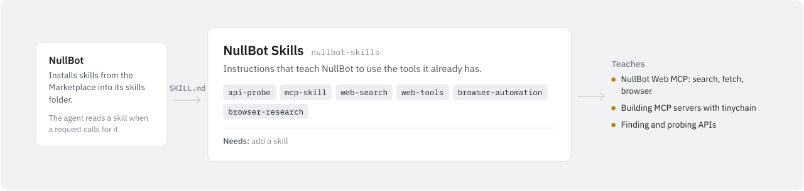

# NullBot Skills

<picture>
  <source media="(prefers-color-scheme: dark)" srcset="assets/nullbot-skills-dark.svg">
  
</picture>

This repository holds the skill packs for NullBot. A skill is a folder with a `SKILL.md` file that the agent reads when a request calls for it. Skills add no capabilities themselves: they are written instructions for using tools the agent already has, from NullBot itself or from installed MCP servers such as `nullbot-web-mcp`.

## How a skill is used

When NullBot starts a run, it reads the skills folder and lists each skill's `name`, `description`, `allowed-tools` (if set) and file path in the agent's instructions. When a request matches a description, the agent opens the full `SKILL.md` (NullBot's `skill_read` tool does this) and follows it. A skill cannot call anything the agent could not already call. If a tool the skill expects is missing, the skill tells the agent to say so instead of pretending.

## Skills

| Skill | What it does | Expects |
| --- | --- | --- |
| `api-probe` | Guides an investigation of a website, service or docs site to find out whether it has an API, how authentication works and which endpoints matter, and ends with a written API brief and a proposal for a small MCP server. | Web or browser tools for live inspection, such as `nullbot-web-mcp`. Its `allowed-tools` lists NullBot built-ins: `market_list_available`, `market_read_package`, `market_install_package`, `mcp_list_servers`, `config_dir_list`, `config_dir_read`, `skills_list`, `history_recent`, `logs_recent`. |
| `mcp-skill` | Describes how to design, build, test, release and list a Go MCP server built on `tinychain/mcp`: tool design, repository layout, release files (`.exe`, `-small.exe`, `SHA256SUMS.txt`) and Marketplace metadata. | File and command tools to do the work, such as `nullbot-code-mcp`. Its `allowed-tools` lists the same NullBot built-ins as `api-probe` plus `mcp_enable_server`, `mcp_disable_server` and `mcp_remove_server`. |
| `web-search` | Explains how to search the web, choose sources, fetch public pages and pull readable text, and base answers on fetched pages rather than search snippets. | `nullbot-web-mcp`: `web_workspace_info`, `list_search_providers`, `web_search`, `fetch_url`. |
| `web-tools` | Explains when to search, when to fetch and when to drive a browser, using the least powerful tool that works, and lists the Web MCP safety rules. | `nullbot-web-mcp`: the search and fetch tools above plus all `browser_*` tools. |
| `browser-automation` | Explains how to drive a Chromium-family browser safely: check status, launch or attach, navigate, read and query before clicking or typing, take screenshots, manage tabs, and respect the `browser_eval` gate. | `nullbot-web-mcp`: `web_workspace_info`, `browser_status`, `browser_launch`, `browser_attach`, `browser_navigate`, `browser_read`, `browser_query`, `browser_click`, `browser_type`, `browser_screenshot`, `browser_tabs`, `browser_eval`. |
| `browser-research` | Lays out multi-step research: search, fetch pages first, use the browser only when a page needs rendering, record evidence and cite the URLs read. | `nullbot-web-mcp`: search and fetch tools and the browser tools except `browser_click`, `browser_type` and `browser_eval`. |

The four web skills (`web-search`, `web-tools`, `browser-automation`, `browser-research`) are new in this update. Like `api-probe` and `mcp-skill`, they live on `main`, which is the branch the Marketplace downloads from.

Notes for the web skills:

- Live `web_search` needs a Brave Search API key. In the NullBot desktop app, add it under Settings > Accounts; NullBot passes it to the Web MCP as `BRAVE_API_KEY`. Without a key, the skills fall back to URLs the user provides.
- `browser_eval` works only when `nullbot-web-mcp` runs with `--allow-eval=true`. It is off by default.
- Screenshots are saved as workspace-relative `.png` paths.

Layout:

```text
skills/
  api-probe/SKILL.md
  browser-automation/SKILL.md
  browser-research/SKILL.md
  mcp-skill/SKILL.md
  web-search/SKILL.md
  web-tools/SKILL.md
```

## Install

From the desktop app: open Tools > Marketplace. It lists each skill pack: API Probe Skill (`api-probe`), MCP Skill (`mcp-skill`), Web Search Skill (`web-search`), Web Tools Skill (`web-tools`), Browser Automation Skill (`browser-automation`) and Browser Research Skill (`browser-research`). Installing one downloads `skills/<name>/SKILL.md` from the `main` branch of this repository and writes it to `~/.nullbot/skills/<name>/SKILL.md`. Choose "Reinstall" to pick up a newer version. Installed skills appear under Tools > Skills.

By hand: copy a skill folder into `~/.nullbot/skills/`, so the file ends up at `~/.nullbot/skills/<name>/SKILL.md`. On Windows, `~` is your user profile folder. If you set `NULLBOT_APP_DIR`, use `<that folder>/skills/` instead. NullBot picks up the skill on the next run.

## Write a new skill

1. Create `skills/<name>/SKILL.md`. Use lowercase letters, digits and hyphens for the folder name and use the same value for `name`.
2. Start the file with frontmatter: a `---` line, one `key: value` per line, and a closing `---` line. `name` and `description` are required; NullBot skips a file that lacks either. Values must fit on one line.
3. Windows line endings (CRLF) and a byte order mark are fine from NullBot v0.5.0; older versions skip such a file, so save with LF if you share skills with them.
4. Optionally add `allowed-tools`, a comma- or space-separated list of tool names. NullBot shows it next to the skill, but it does not grant or restrict any tool. `license` and `compatibility` are also read if present.

```markdown
---
name: example-skill
description: One sentence that says when to use this skill.
allowed-tools: web_search, fetch_url
---

# Example skill

Use this skill when ...

This skill gives guidance only. It does not grant tools by itself.
```

Guidelines:

- Write the `description` as one sentence about when the skill applies. It is all the agent sees until it opens the file.
- Keep the body short: when to use the skill, the steps, and the safety rules.
- Name tools exactly (`fetch_url`, not "the fetch tool") and name the server they come from. Say what to do when a tool is missing.
- State that the skill grants nothing by itself, and never put credentials in a skill.
- NullBot can read other Markdown files that `SKILL.md` refers to inside the same folder, but the Marketplace installs only `SKILL.md`. Keep a skill meant for the Marketplace in one file.
- To list a new skill in the Marketplace, it also needs an entry in NullBot's built-in catalog (`pkg/app/market.go` in `Bradthebrad/nullbot`).
